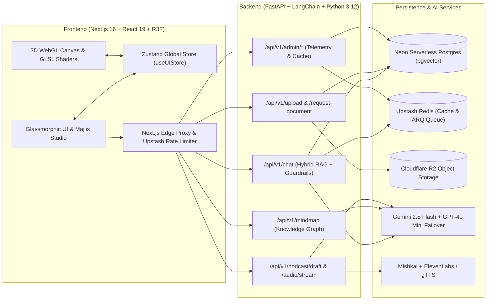

# الراوي • Al-Rawi (The Storyteller)

**Al-Rawi** is a bilingual (English / Arabic RTL), spatial 3D AI Heritage & Tourism Oracle for exploring Saudi Arabia's UNESCO World Heritage sites (such as **At-Turaif in Diriyah**, **Hegra / Al-Hijr in AlUla**, and **Historic Jeddah**). It pairs an isolated WebGL 3D canvas (`@react-three/fiber` + custom GLSL desert and holographic shaders) with a glassmorphic Next.js 16 interface and a resilient FastAPI + LangChain RAG backend powered by **Gemini 2.5 Flash**.

---

## Architecture Overview



---

## Core Capabilities

1. **Spatial 3D WebGL Heritage Canvas**:
   - Isolated `@react-three/fiber` and `@react-three/drei` scene with custom procedural GLSL sand and holographic wireframe shaders ([`DesertSandShader.ts`](frontend/src/components/canvas/shaders/DesertSandShader.ts)).
   - Camera position, rotation speed, and post-processing bloom respond dynamically to AI thinking state, selected mind-map nodes, and real-time audio frequencies (`AnalyserNode`).
2. **Resilient Multi-Tenant RAG Pipeline**:
   - Hybrid vector retrieval on **Neon Serverless PostgreSQL (`pgvector`)** with tenant namespace isolation (`SHA-256` collection derivation), semantic caching (`0.95` similarity threshold), context deduplication, and automatic failover from **Gemini 2.5 Flash** to **GPT-4o Mini** and offline historical fallbacks.
   - Built-in AI safety & prompt-injection guardrails ([`guardrails.py`](backend/app/services/guardrails.py)).
3. **Interactive Knowledge Graph (`@xyflow/react`)**:
   - Synthesizes historical entities and relationships into an interactive node graph ([`MindMap.tsx`](frontend/src/components/ui/MindMap.tsx)) that focuses the 3D camera when nodes are selected.
4. **"The Majlis" Podcast Studio & Vocal Synthesis**:
   - Generates editable two-speaker dialogue scripts (`Visitor` and `Rawi`) grounded in UNESCO archival context, applies Arabic diacritization via `Mishkal`, and streams synthesized audio via **ElevenLabs** (`eleven_multilingual_v2`) with automatic **gTTS** fallback.
5. **Multimodal UX & UNESCO Geofencing**:
   - Bilingual `next-intl` support (`en` / `ar` RTL), Web Speech API voice input, interactive source citation drawers, procedural Web Audio UI sound effects, and Haversine geofencing for Diriyah, AlUla, and Historic Jeddah.

---

## Repository Structure

```text
Al-Rawi/
├── frontend/               # Next.js 16 (App Router, Turbopack), React 19, R3F, Tailwind v4, Biome
│   ├── src/app/            # Localized routes ([locale]/page.tsx, [locale]/admin/page.tsx) & API proxy
│   ├── src/components/     # 3D Canvas, Glassmorphic UI, Chat, and Admin components
│   ├── src/hooks/          # useSoundDesign & useGeofence hooks
│   ├── src/store/          # Zustand state synchronization (useUIStore)
│   └── src/tests/          # Frontend verification scripts
├── backend/                # FastAPI, LangChain, PGVector, ARQ, Structlog, Sentry
│   ├── app/api/v1/         # REST endpoints (chat, documents, mindmap, podcast, admin)
│   ├── app/services/       # RAG, ingestion, guardrails, mindmap, podcast, storage
│   └── tests/              # Pytest unit, RLS, safety, and RAGAS evaluation suite (41 tests)
├── docs/                   # PRD, C4 Architecture, ERD, OpenAPI Spec, & Superpowers SDD Plans
├── PROMPTS.md              # System prompts, RAG templates, and guardrail policies
└── render.yaml             # Infrastructure-as-Code blueprint for Render deployment
```

---

## Quick Start

### 1. Backend Setup (`backend/`)

```bash
cd backend
uv sync --all-extras --dev
cp .env.example .env
# Populate GOOGLE_API_KEY, DATABASE_URL, and REDIS_URL in .env

# Start the FastAPI server
uv run uvicorn app.main:app --reload --host 0.0.0.0 --port 8000
```

### 2. Frontend Setup (`frontend/`)

```bash
cd frontend
pnpm install
cp .env.example .env.local

# Start the Next.js development server
pnpm dev
```

Open `http://localhost:3000` to launch the Al-Rawi experience.

---

## Verification & Quality Gates

### Backend Checks
```bash
cd backend
uv run ruff check .
uv run ruff format --check .
uv run pytest tests/ -v
```

### Frontend Checks
```bash
cd frontend
pnpm format:check
pnpm lint
pnpm test
pnpm exec tsc --noEmit
```

---

## Documentation Index

- [Product Requirements Document (PRD)](docs/product/PRD.md)
- [C4 System Architecture](docs/architecture/c4-architecture.md)
- [Entity-Relationship Diagram (ERD)](docs/architecture/erd.md)
- [OpenAPI 3.1 Specification](docs/architecture/openapi.yaml)
- [System Prompts & Guardrail Engineering](PROMPTS.md)
- [Frontend Workspace Documentation](frontend/README.md)
- [Backend Workspace Documentation](backend/README.md)

---

## License

This project is licensed under the **Creative Commons Attribution-NonCommercial 4.0 International (CC BY-NC 4.0)** license. See [LICENSE](LICENSE) for full details.
