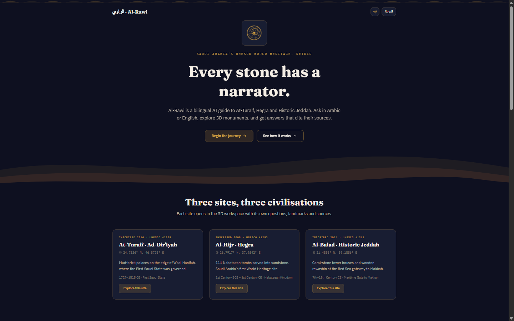
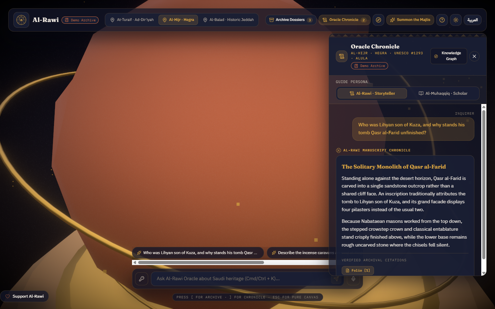
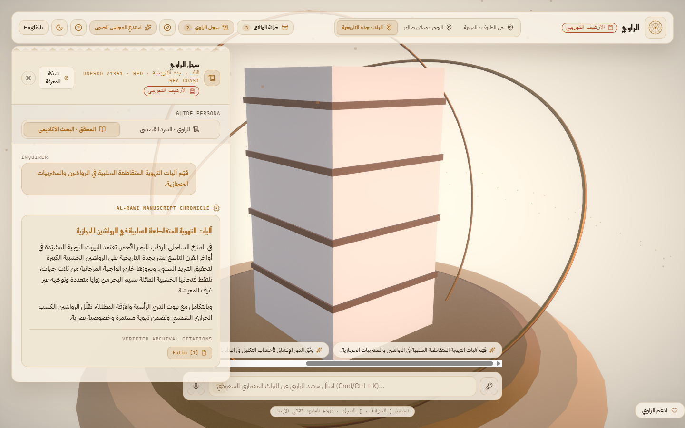
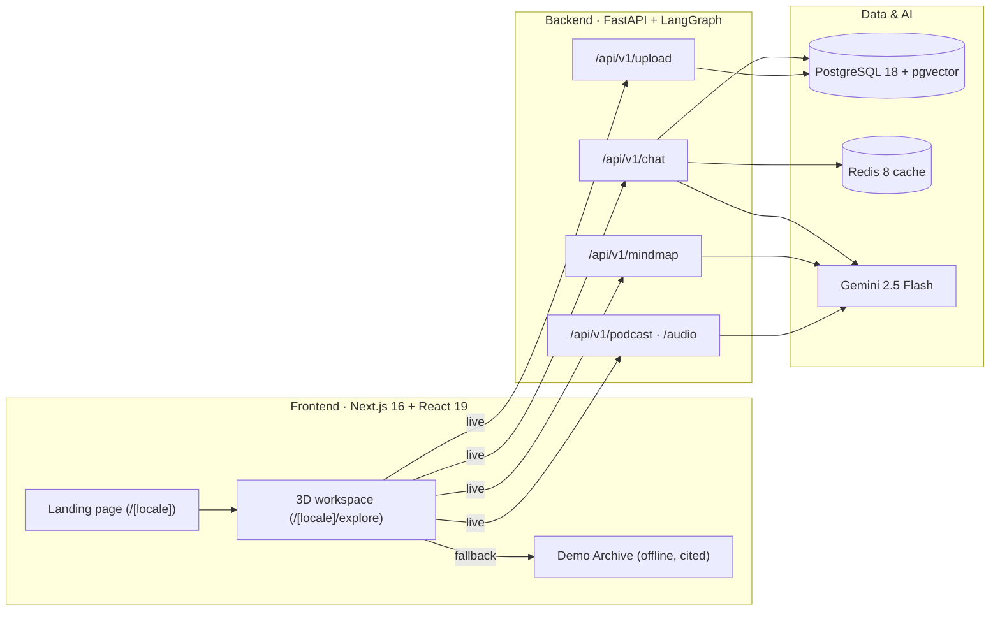

# الراوي · Al-Rawi

**Every stone has a narrator.** A bilingual (Arabic / English) AI guide to Saudi Arabia's UNESCO World Heritage sites (At-Turaif in Ad-Dir'iyah, Hegra in AlUla, and Historic Jeddah) with 3D monuments, cited answers, knowledge maps and narrated conversations.

[](https://github.com/D0nG4667/Al-Rawi/actions/workflows/ci.yml)


[](LICENSE)



| Explore Hegra (Desert Night) | Historic Jeddah in Arabic (Sunlit Sandstone) |
|---|---|
|  |  |

---

## Why Al-Rawi

**The problem.** The best knowledge about Saudi heritage sits in 300-page UNESCO nomination dossiers, masterplans and archival journals. Visitors never read them, and generic chatbots answer without sources.

**The solution.** Al-Rawi turns those primary sources into an interactive, Arabic-first guide. Every answer cites the document it came from, and every site can be explored in 3D.

**Who it serves.**

| Audience | Value |
|---|---|
| Heritage authorities | An accurate, citable public guide built from your own dossiers and conservation reports |
| Tourism operators | A memorable bilingual companion before, during and after a visit |
| Visitors and educators | Explore the sites in 3D, ask anything, learn from the sources themselves |

---

## Try it in 60 seconds

No API keys and no backend needed: the workspace answers from a curated **Demo Archive** of cited answers based on the official UNESCO listings, and marks those answers with a visible "Demo Archive" badge.

```bash
pnpm --dir frontend install
pnpm dev:web            # http://localhost:3000
```

Deep links work out of the box, e.g. `http://localhost:3000/en/explore?site=hegra&persona=ACADEMIC`.

Set `NEXT_PUBLIC_DEMO_MODE=always` in `frontend/.env.local` to force demo answers (kiosks, pitches).

### Full stack (live research over your own documents)

```bash
pnpm install                                  # root tooling + Lefthook hooks
pnpm bootstrap                                # frontend deps + backend virtualenv (uv)
cp backend/.env.example backend/.env          # add GOOGLE_API_KEY
cp frontend/.env.example frontend/.env.local
pnpm services:up                              # Postgres 18 (pgvector) + Redis 8
pnpm dev                                      # FastAPI :8000 + Next.js :3000
```

---

## Capabilities

1. **Cinematic bilingual landing page** with deep links into each site.
2. **3D heritage workspace**: procedural monuments for At-Turaif, Hegra and Historic Jeddah, camera waypoints, Desert Night and Sunlit Sandstone themes.
3. **Cited answers**: hybrid `pgvector` retrieval with Gemini 2.5 Flash; each answer lists its sources and opens the excerpt and original record.
4. **Never breaks in a demo**: automatic fallback to the Demo Archive on network errors, timeouts or server errors; configuration errors (e.g. a bad API key) are shown, not hidden.
5. **Guided first-run tour**: four accessible steps, keyboard and RTL aware.
6. **Knowledge graph** of people, places and periods (`@xyflow/react`).
7. **The Majlis**: editable two-voice conversations with narration (ElevenLabs / gTTS, browser voice fallback).

---

## Architecture



---

## Trust & citation integrity

- Answers cite their sources; citations open the excerpt and, where available, the original document.
- Demo Archive answers cite only the official UNESCO World Heritage List entries ([1329](https://whc.unesco.org/en/list/1329), [1293](https://whc.unesco.org/en/list/1293), [1361](https://whc.unesco.org/en/list/1361)) and are labelled as demo content. Page numbers are shown only when verified.
- The full stack can be deployed on your own infrastructure.

---

## Quality gates

| Layer | Tooling |
|---|---|
| Toolchain | Node 26 LTS (`.node-version`), `packageManager: pnpm@10.23.0`, Python 3.12 via `uv` |
| Frontend | Biome 2, `tsc --noEmit`, 12 verification suites (`pnpm --dir frontend test`) |
| Backend | Ruff lint + format, 41 pytest tests with mocked LLM and network calls |
| Git hooks | Lefthook: Biome, Ruff, gitleaks, commitlint, pre-push tests |
| CI/CD | Path-filtered jobs, Docker build + Trivy scan, CodeQL, dependency review, release-please |

```bash
pnpm check   # Biome, tsc, frontend tests, Ruff, pytest
pnpm fix     # auto-fix both stacks
```

---

## Roadmap

| Status | Milestone |
|---|---|
| ✅ Shipped | Landing page, Demo Archive mode, guided tour, deep links |
| 🗓️ Planned | Mobile and touch hardening, WCAG 2.2 AA audit, 3D performance budgets, offline PWA |
| 🗓️ Planned | Compliance: data residency, audit trails, PDPL / NCA alignment |
| 🗓️ Planned | Enterprise: white-label theming, visitor analytics, SSO, multi-tenant admin |
| 🗓️ Planned | Content: more UNESCO sites, Arabic narration voices, itineraries |

---

## Documentation

- [Product Requirements (PRD)](docs/product/PRD.md)
- [C4 Architecture](docs/architecture/SYSTEM_C4.md) · [ERD](docs/architecture/DATABASE_ERD.md) · [API Contracts](docs/architecture/API_CONTRACTS.md) · [Data Flow](docs/architecture/DATA_FLOW.md)
- [Git Workflow](docs/architecture/GIT_WORKFLOW.md) · [Contributing](CONTRIBUTING.md)
- [System Prompts & Guardrails](PROMPTS.md)
- [Frontend](frontend/README.md) · [Backend](backend/README.md)

## License

[Creative Commons Attribution-NonCommercial 4.0 International (CC BY-NC 4.0)](LICENSE).
