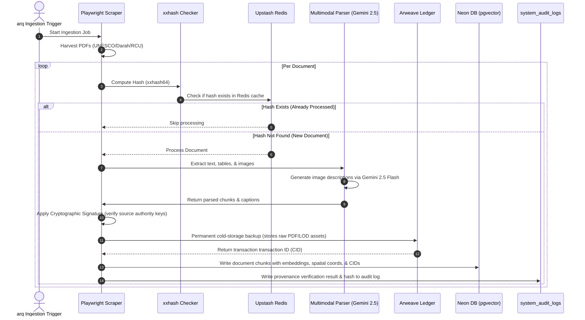

# Data Ingestion & RAG Data Flow

This document details the step-by-step pipeline mapping how raw PDF source dossiers, map boundaries, and 3D ruins are harvested, processed, verified, and indexed within the Al-Rawi system.

## Ingestion Pipeline Flow

