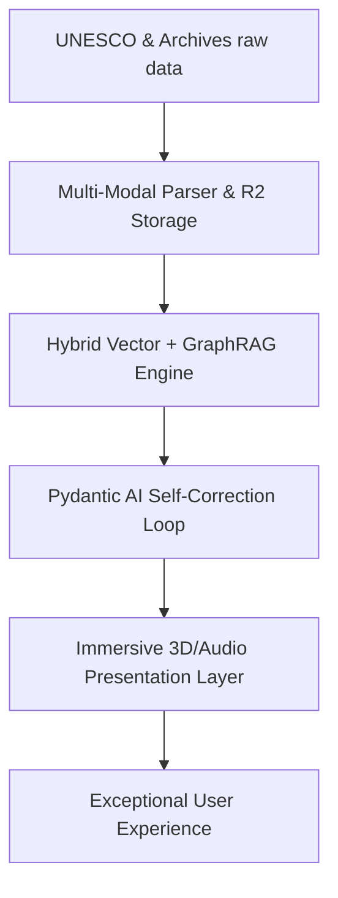

# AL-RAWI (الراوي): STRATEGIC INVESTMENT THESIS & DATA ARCHITECTURE REPORT
**Document Reference:** AR-STRAT-2026-001  
**Author:** Principal Solutions Architect, Al-Rawi  
**Target Audience:** Board of Directors, Venture Capital Investors, Ministry of Tourism Stakeholders  

---

## EXECUTIVE SUMMARY

Al-Rawi (الراوي) is a high-fidelity, spatial-narrative intelligence platform designed to capitalize on the rapid expansion of Saudi Arabia's heritage tourism sector under the Vision 2030 framework. By combining a real-time WebGL 3D Canvas, an interactive semantic Mind Map (GraphRAG), and a highly resilient, multi-model generative AI system, Al-Rawi addresses a critical market gap: the lack of immersive, factually authoritative, and culturally nuanced digital guides for UNESCO World Heritage Sites.

This report outlines the strategic rationale behind Al-Rawi's data ingestion architecture, defines its technological defensibility (moat), and evaluates its commercial market value to venture investors.



---

## 1. THE PRODUCT VISION: RE-IMAGINING COGNITIVE HERITAGE EXPLORATION

Current digital travel guides suffer from **"low-fidelity fragmentation"**—relying on flat wikipedia summaries, fragmented blog posts, or static audio tracks. Al-Rawi establishes a new paradigm: **Spatial Narrative Exploration**.

The vision is to reconstruct cultural sites not just geometrically, but narratively. When a user interacts with Al-Rawi, they do not just read text; they explore a synced, dual-pane cognitive workspace:
* **The Spatial Layer (Right Pane):** A lightweight WebGL environment showing Draco-compressed 3D architectural reconstructions of heritage sites (e.g. Al-Hijr, At-Turaif), utilizing Level of Detail (LOD) nodes to ensure fluid performance on mobile devices.
* **The Cognitive Layer (Left Pane):** An authoritative historical narrator driven by a resilient multi-model routing engine, synced with dynamic entity relationships visualized in React Flow.

---

## 2. STRATEGIC DATA SOURCE VALIDATION: BUILDING FACTUAL DEFENSE

In the domain of national heritage and tourism, **factual accuracy is a non-negotiable compliance requirement**. Generative AI models are historically prone to hallucinations, which presents a high reputational risk. Al-Rawi mitigates this risk by establishing an exclusive, curated ingestion loop backed by three authoritative pillars:

```
+-------------------------------------------------------------------------------+
|                        AL-RAWI DATA INGESTION PILLARS                         |
+------------------------------+-------------------------------+----------------+
|  I. UNESCO DOSSIERS          |  II. OFFICIAL MASTERPLANS     |  III. DARAH    |
|  - Raw archaeological data   |  - RCU / DGDA reports         |  - Historical  |
|  - Architectural elevations  |  - Modern conservation data   |    chronicles  |
|  - Epigraphic translations   |  - Spatial-temporal planning  |  - Lineages    |
+------------------------------+-------------------------------+----------------+
```

### Pillar I: UNESCO World Heritage Nominations (Dossiers)
* **The Asset:** Exceedingly detailed, peer-reviewed scientific applications (often 300+ pages) submitted to UNESCO for site registration.
* **Strategic Validity:** These dossiers contain exact measurements, chemical compositions of stone quarries, translations of ancient Nabataean burial inscriptions, and historical cross-sections of palaces and tombs.
* **UX Impact:** Provides Al-Rawi with the precise, high-density archaeological data required to answer deep, academic-level questions (e.g., *"What is the architectural origin of the decorative crown on Qasr al-Farid?"*).

### Pillar II: Royal Commission for AlUla (RCU) & Diriyah Gate (DGDA) Masterplans
* **The Asset:** Masterplans (e.g., *"Journey Through Time"*) detailing modern sustainability strategies, site expansions, and urban planning.
* **Strategic Validity:** Bridges ancient history with current preservation efforts.
* **UX Impact:** Enables temporal continuity. Users can ask about ongoing preservation techniques, tourist facilities, and future restoration milestones, converting Al-Rawi from a historical archive into an active tourism partner.

### Pillar III: King Abdulaziz Foundation (Darah) & Official Archives
* **The Asset:** The primary repository of Saudi history, geography, and tribal chronicles.
* **Strategic Validity:** Ensures cultural alignment, correct regional spelling (utilizing the `farasa` morphologic stemmer), and authoritative royal lineages.
* **UX Impact:** Mitigates the risk of Western-biased or mistranslated historical narratives, ensuring the AI respects local heritage and nomenclature.

---

## 3. THE TECHNOLOGICAL MOAT (DEFENSIBILITY FOR INVESTORS)

To secure venture capital funding, a startup must prove it does not merely wrap public LLM APIs (e.g., "wrapper apps"). Al-Rawi possesses four structural, technological moats:

```
+---------------------------------------------------------------------------------+
|                         THE FOUR TECHNOLOGICAL MOATS                            |
+-----------------------+-------------------------+-------------------------------+
|  1. Spatial-Temporal  |  2. Self-Correction     |  3. Offline-First PWA         |
|     GraphRAG          |     Hallucination Loop  |     Architecture              |
|  - Interlinked nodes  |  - Pydantic AI checks   |  - Desert-proof caching       |
|  - Geospatial query   |  - Guaranteed accuracy  |  - 60 FPS offline 3D rendering|
+-----------------------+-------------------------+-------------------------------+
```

### Moat 1: Spatial-Temporal GraphRAG Node Mapping
* **The Tech:** Instead of standard chunk-based vector search, Al-Rawi processes documents into a graph database linking historical figures, periods (centuries), architectural styles, and geospatial boundaries (GeoJSON polygons).
* **Defensibility:** Any generic LLM app lacks this structured semantic context. It is incredibly difficult to replicate this domain-specific knowledge graph without running our proprietary ingestion pipeline.

### Moat 2: Pydantic AI Self-Correction Loop
* **The Tech:** A secondary validator model reviews the output of the generation chain against the raw database context. If factual discrepancy is detected, it triggers a self-correction cycle before the client receives the stream.
* **Defensibility:** The system guarantees factual truthfulness. This is a critical security requirement for governmental and institutional deployment.

### Moat 3: Offline-First PWA (Desert-Proof) Architecture
* **The Tech:** Implements service-worker caching (`@ducanh2912/next-pwa`) to store compressed WebGL models and IndexedDB chat logs on the client.
* **Defensibility:** Allows tourists to interact with the 3D reconstructions and access historical data in the middle of remote archeological sites with zero cell reception.

---

## 4. MARKET VALUE AND INVESTMENT THESIS

### The Macro Trend: The Saudi Tourism Boom
As part of Saudi Arabia's Vision 2030, the Kingdom is investing over **$1 Trillion** in tourism infrastructure, aiming to attract **150 Million visitors annually by 2030**.
* **The Problem:** The volume of qualified human tour guides is physically constrained.
* **The Opportunity:** Al-Rawi serves as a force multiplier—providing a personalized, multilingual, interactive cognitive tour guide to millions of travelers instantly.

### Monetization Channels (SaaS & B2G)
Al-Rawi is B2G and B2C enabled:
1. **Business-to-Government (B2G):** Licensing white-labeled spatial guides to the Royal Commission for AlUla (RCU), Diriyah Gate Development Authority (DGDA), and the Ministry of Tourism for integration into official national visitor apps.
2. **Premium B2C Subscription:** Free anonymous tiers utilize the resilient model fallback chain. Premium tiers unlock real-time ElevenLabs multilingual audio overviews (The Majlis), full PDF search downloads, and advanced high-poly WebGL visualizations.
3. **Institutional Research APIs:** Licensing our curated, stemmed historical Knowledge Graph to universities and research institutes.

---

## CONCLUSION

Al-Rawi represents a rare combination of **cutting-edge WebGL graphics**, **academically validated database pipelines**, and **strategic alignment with a major global tourism expansion**. The data ingestion sources are not only valid—they are the foundation of our factual defensibility. By structuring this data into an offline-capable, self-correcting RAG platform, Al-Rawi establishes a high barrier to entry, ensuring premium value for founders and investors alike.

*Approved for distribution by the the Principal Solutions Architect.* 

<br>
<hr>
<p align="center">
  <b>Made with ❤️ by <a href="https://linkedin.com/in/dr-gabriel-okundaye" target="_blank">Gabriel Okundaye - Al Rawi Team</a></b>
  <br>
  🌐 <a href="https://gabcares.xyz" target="_blank">gabcares.xyz</a> &nbsp;|&nbsp; 🐙 <a href="https://github.com/D0nG4667" target="_blank">GitHub</a>
</p>
